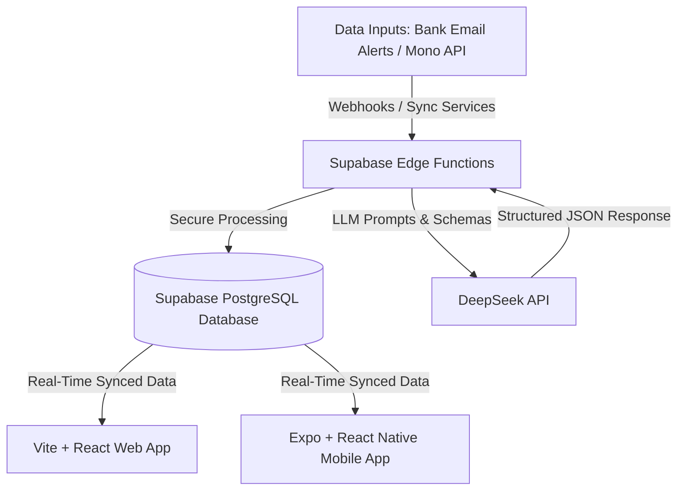
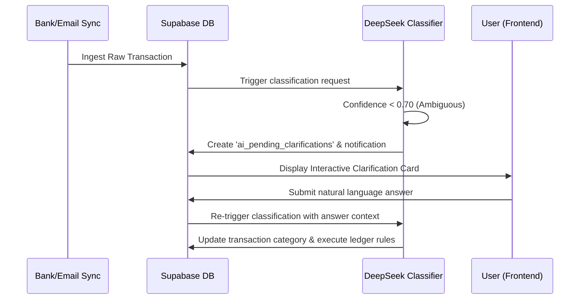
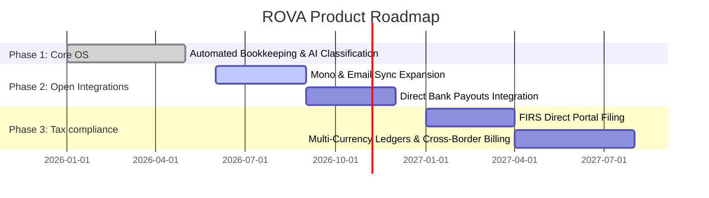

# PRODUCT REQUIREMENT DOCUMENT (PRD)

## ROVA: Intelligent Financial Operating System for African SMEs
**Document Version:** 1.0 (Enterprise Ready)  
**Date:** May 26, 2026  
**Authors:** ROVA Product & Engineering Teams  
**Target Audience:** Venture Capital (VC) Investment Committees, Technical Evaluators, Board of Directors  

---

## 1. Executive Summary
Small and Medium Enterprises (SMEs) represent over 90% of businesses and 80% of employment in Sub-Saharan Africa. However, more than 50% of African SMEs fail within their first five years, primarily due to poor cash flow management, lack of formal financial records, and complex local tax compliance systems. 

**ROVA** is an autonomous, AI-driven Financial Operating System designed specifically for African SMEs (starting with Nigeria). Unlike generic accounting platforms (e.g., QuickBooks, Xero) which require manual data entry and professional bookkeeping knowledge, ROVA automates the entire bookkeeping lifecycle. By integrating open banking feeds (Mono API), email statement parsing (Gmail/Outlook), and advanced LLM agents (DeepSeek), ROVA ingests transactions in real time, auto-classifies them, posts them to a double-entry general ledger, adjusts inventory stock levels, processes payroll, and computes compliant local tax liabilities (FIRS) without requiring human accounting intervention.

For the user, ROVA operates as a conversable financial co-pilot (ROVA Assistant) accessible via Web and Mobile, translating raw transaction data into natural language business intelligence and executing complex business operations through simple conversational commands.

---

## 2. Problem Statement & Market Opportunity

### 2.1 The Problem
1. **The "Bookkeeping Tax":** SME founders spend up to 15 hours a week manually logging expenses, invoicing, and sorting receipts, distractng them from core business growth.
2. **The Data Gap:** Over 80% of transactions occur via bank transfers with vague descriptions (e.g., *"Transfer from Kola"* or *"Payment for bags"*). Traditional software fails to categorize these, leading to inaccurate books.
3. **Regulatory Compliance Failure:** Calculating PAYE, VAT, Company Income Tax (CIT), and Withholding Tax (WHT) under the Nigerian Finance Act is extremely difficult for non-accountants. Fines for late filings or miscalculations frequently drain business capital.
4. **Cost of Professional Services:** Hiring a certified accountant costs between ₦150,000 to ₦500,000 monthly, which is cost-prohibitive for early-stage or micro-SMEs.
5. **Inventory & Cost of Goods Sold (COGS) Mismatch:** Businesses struggle to track how stock purchases relate to cash outflows and how sales invoices decrement stock levels, leading to stockouts or undetected shrinkage.

### 2.2 The Market Opportunity
There are over 40 million MSMEs in Nigeria alone. The financial software market for African SMEs is highly underpenetrated. Traditional systems are too complex, while local ledger apps (e.g., Kippa, Bumpa) remain manual. ROVA’s opportunity is to capture this market by providing an **autonomous, self-reconciling bookkeeping engine** that acts as both the banking connector and the virtual accountant.

---

## 3. Product Vision & Core Pillars

ROVA is built on three core product pillars:
1. **Zero-Touch Ingestion:** No manual logging. Financial transactions are captured automatically from bank APIs and transaction notification emails.
2. **Autonomous Accounting (AI-Led):** LLM-based categorization that understands local Nigerian business contexts (e.g., identifying supplier names, inventory items, and employee salaries from messy bank alerts).
3. **Natural Language Business Intelligence:** A conversational interface that turns complex accounting reports (Balance Sheets, P&Ls) into clear answers to questions like *"How much did I spend on inventory this month?"* or *"Can I afford to hire a new staff member?"*

---

## 4. Technical Architecture & System Stack

The ROVA platform is engineered using a scalable, serverless, and secure architecture:



### 4.1 Frontend Tier
* **Web App:** Single Page Application built on **React 18**, **TypeScript**, and **Vite**. UI styling is implemented via vanilla CSS variables for responsive layouts, rapid rendering, and sleek aesthetics (dark mode, glassmorphism card panels).
* **Mobile App:** Cross-platform native application built on **Expo** and **React Native**, ensuring that business owners have access to real-time financial tracking on the go.

### 4.2 Backend & Data Tier
* **Database & Hosting:** Hosted on **Supabase** (built on PostgreSQL 15).
* **Security:** Row Level Security (RLS) policies are active across all database tables, isolating multi-tenant data at the SQL level.
* **Serverless Functions:** Supabase Edge Functions written in TypeScript running on **Deno** host the business logic, API integrations, and LLM gateway.

### 4.3 AI & Engine Tier
* **LLM Engine:** **DeepSeek Chat (deepseek-chat)** utilized via Supabase Edge Functions. The system instructs the LLM to output structured JSON responses conforming to exact schema specifications, ensuring reliability.
* **Fallback Systems:** Keyword-based regex heuristics process transactions locally if the LLM provider experiences latency or outages, guaranteeing 100% service uptime.

---

## 5. Functional Modules & Deep-Dive Requirements

### Component A: Automated Transaction Ingest (Email & Open Banking Sync)
* **Objective:** Automatically extract and record financial inflows and outflows without manual user data entry.
* **Capabilities:**
  1. **Mono API Integration:** Connects user accounts directly to Nigerian commercial bank accounts. Exchanged bank tokens are used to fetch balances and transaction histories.
  2. **Automated Email Sync (Gmail/Outlook OAuth):** Users connect their business email accounts. An automated runner triggers Gmail API queries filtered by bank-specific senders (e.g., `zenithbank.com`, `gtbank.com`, `firstbanknigeria.com`).
  3. **MIME Alert Parsing:** The backend Deno function (`email-bank-sync`) extracts HTML bodies, strips styling and scripts, decodes entity encodings (like `&#8358;` to `₦`), and parses transaction attributes:
     * **Amount & Balance:** Extracted using decimal matching.
     * **Transaction Type:** Identified as *income* (credited) or *expense* (debited).
     * **References:** Scrapes bank session IDs or transaction references to prevent duplication.
     * **Description:** Normalizes the transfer narration.

### Component B: AI Transaction Classification & Autonomous Intent Engine
* **Objective:** Map messy, raw transaction descriptions into structured accounting categories and execute secondary business actions automatically.
* **Workflow:**
  1. Once a transaction is ingested, the system calls the `ai-classify` edge function.
  2. The LLM is provided with contextual metadata: the user's active employee directory, active inventory catalog, and available chart of accounts.
  3. **Intent Detection Rules:**
     * **`salary_payment` Intent:** If a transaction description matches a salary outflow, the AI extracts the employee's name, matches them in the database, generates a payroll run, and computes PAYE/pension deductions.
     * **`inventory_purchase` Intent:** If it matches a stock purchase, the AI extracts the item name, matches it in the inventory database, increments stock levels, and logs an inventory transaction.
     * **`invoice_payment` Intent:** If it matches a client payment, it links it to the corresponding invoice.

### Component C: Human-in-the-Loop Clarification Engine
* **Objective:** Resolve transaction ambiguity (e.g. low LLM confidence or vague descriptions like *"Transfer from Kola"*) without breaking the ledger.
* **Capabilities:**
  1. If the classification confidence falls below `0.70`, the system marks `clarification_needed: true` and generates a user-friendly question (e.g., *"You received ₦50,000 from Kola. Was this for a sale, or is it a loan?"*).
  2. The transaction is placed in `ai_pending_clarifications` in a `pending` state, and an in-app notification is dispatched.
  3. The user answers the question directly from the **ROVA Assistant** interface.
  4. The response is appended to the transaction description and re-submitted to the classification engine, posting the transaction to the ledger.



### Component D: Double-Entry Bookkeeping Ledger
* **Objective:** Maintain a certified, GAAP-compliant financial ledger for auditing and tax preparation.
* **Capabilities:**
  1. **Chart of Accounts (COA):** Seeded default chart with 5 primary classes: Assets, Liabilities, Equity, Revenues, and Expenses. Users can add custom sub-accounts.
  2. **Balanced Journal Entries:** Every financial event triggers a journal entry header (`journal_entries`) and a minimum of two entry lines (`journal_entry_lines`). Debits must equal credits.
  3. **Financial Statement Generator:** Compiles dynamic financial statements from ledger lines:
     * **Profit & Loss:** Revenues minus Expenses.
     * **Balance Sheet:** Assets vs Liabilities + Equity.
     * **Cash Flow Statement:** Cash flows categorized by Operating, Investing, and Financing activities.
     * **Trial Balance:** Verifies accounting balance.

### Component E: Automated Payroll & Deduction Engine
* **Objective:** Automate employee compensation processing and statutory benefit deductions.
* **Capabilities:**
  1. **Employee Profiles:** Stores gross salaries, bank information, role, and department.
  2. **Statutory Computations:** Auto-calculates deductions based on Nigerian payroll regulations:
     * **PAYE (Personal Income Tax):** Deducted using progressive tax brackets (7% to 24%).
     * **Pension Contributions:** Auto-calculates employer/employee contributions (defaults to 8.0% employee deduction).
  3. **Payroll Run Lifecycle:** Payroll runs progress from `draft` to `processed`.
  4. **Payslip Integration:** Generates digital payslips automatically, linking bank salary transaction payouts to employee pay records.

### Component F: Connected Inventory & Cost of Goods Sold (COGS)
* **Objective:** Track stock quantities and calculate cost of goods sold.
* **Capabilities:**
  1. **Supplier Management:** Supplier directory storing contacts, payment terms (e.g., Net 30), and billing histories.
  2. **Stock Catalog:** Tracks items by SKU, unit cost, selling price, and reorder thresholds.
  3. **Real-time Stock Transactions:** Records stock movements (`purchase`, `sale`, `adjustment`, `write_off`).
  4. **Low-Stock Alerts:** Automatically flags items when stock drops below designated reorder levels, prompting the user via the ROVA Assistant.

### Component G: Invoicing & Accounts Receivable
* **Objective:** Accelerate collections and track outstanding revenue.
* **Capabilities:**
  1. **Invoice Builder:** Supports creation of drafts, line-item configurations, tax rates (VAT), due dates, and custom notes.
  2. **Payment Tracking:** Status transitions (`draft` -> `sent` -> `paid` / `overdue` / `cancelled`).
  3. **Automated Ledger Reconciliation:** Mark-as-paid actions generate balanced debit/credit lines, increasing cash/bank assets and clearing accounts receivable.

### Component H: Tax Compliance Engine (FIRS Compliant)
* **Objective:** Remove tax penalties by keeping businesses audit-ready.
* **Capabilities:**
  1. **Statutory Tax Calculations:**
     * **VAT (Value Added Tax):** Configured to Nigeria's standard 7.5% rate. Helps track registration compliance (mandatory for companies with annual turnover ≥ ₦25M).
     * **PIT/PAYE (Personal Income Tax):** Auto-calculates deductions using progressive tax brackets:
       * First ₦300,000: **7%**
       * Next ₦300,000: **11%**
       * Next ₦500,000: **15%**
       * Next ₦500,000: **19%**
       * Next ₦1,600,000: **21%**
       * Above ₦3,200,000: **24%**
     * **CIT (Company Income Tax):** Estimates corporate taxes based on corporate earnings brackets:
       * Small Companies (Turnover < ₦25M): **0%**
       * Medium Companies (Turnover ₦25M - ₦100M): **20%**
       * Large Companies (Turnover > ₦100M): **30%**
     * **WHT (Withholding Tax):** Tracks deductions at source (5% to 10% depending on contracts/services).
     * **CGT (Capital Gains Tax):** Configured for capital gains calculations (10% rate).
  2. **Tax Filing Calendars:** Visual reminders and notifications mapped to Nigerian filing deadlines (e.g., VAT by the 21st of the following month, PAYE by the 10th).
  3. **Audit Export:** Single-click CSV export formats reports for easy tax portal uploads.

### Component I: Conversational AI Assistant (Co-pilot)
* **Objective:** Provide a natural language financial dashboard.
* **Capabilities:**
  1. **Multi-turn Chat:** LLM-backed chat interface that retains the history of the conversation context.
  2. **Context-Aware Analytics:** The prompt includes recent transaction histories, accounts balances, and employee rosters.
  3. **Direct Action Dispatching:** The assistant parses intent and generates UI buttons, allowing the user to initiate actions directly from the chat:
     * *“Create invoice for client X”* -> Returns a `create_invoice` action card.
     * *“Record inventory”* -> Returns an `add_inventory` action card.
     * *“Check runway”* -> Analyzes average monthly burn rate against cash balances to estimate cash reserves.

### Component J: Multi-User Role-Based Access Control (RBAC) & Audit Logs
* **Objective:** Ensure data security and maintain audit trails.
* **Capabilities:**
  1. **Roles and Permissions:**
     * **Owner:** Full system access.
     * **Admin:** Full operation, excluding business transfer permissions.
     * **Accountant:** Full access to journals, ledger, statements, and tax reports.
     * **Staff:** Restricted to invoicing and stock logging; cannot view profit margins, salary directories, or cash balances.
     * **Viewer:** Read-only access.
  2. **Immutable Audit Trails:** The `activity_logs` table logs every creation, update, deletion, or ledger post, storing metadata (IP address, user ID, pre/post state changes) for security compliance.

---

## 6. Database Schema Design (PostgreSQL/Supabase)

Below is the database architecture that powers the ROVA platform. All tables are relational, index-optimized, and secured via PostgreSQL Row Level Security.

| Table Name | Primary Key | Key Foreign Keys | Purpose |
| :--- | :--- | :--- | :--- |
| **`profiles`** | `id` (uuid) | References `auth.users` | Extends auth data with business metadata, operating mode, and NGN currency defaults. |
| **`accounts`** | `id` (uuid) | `user_id` | Tracks bank/wallet names, balances, institutions, and sync settings. |
| **`connected_banks`** | `id` (uuid) | `user_id` | Stores open banking metadata (Mono API account credentials). |
| **`bank_email_sync_settings`** | `id` (uuid) | `user_id`, `account_id` | OAuth configurations and sender filters for Gmail/Outlook alert parsers. |
| **`categories`** | `id` (uuid) | `user_id` | Transaction categories. Pre-seeded with system defaults (Salary, Business Revenue, Inventory, etc.). |
| **`transactions`** | `id` (uuid) | `user_id`, `account_id`, `category_id` | Ledger transaction entries containing transaction type, amount, date, and source metadata. |
| **`invoices`** | `id` (uuid) | `user_id` | Invoice details including totals, tax liabilities, customer records, and statuses. |
| **`invoice_items`** | `id` (uuid) | `invoice_id` | Line items detailing quantity, item description, and unit price. |
| **`chart_of_accounts`** | `id` (uuid) | `user_id`, `parent_id` | Ledger accounts mapped to account types (Asset, Liability, Equity, Income, Expense). |
| **`journal_entries`** | `id` (uuid) | `user_id`, `transaction_id` | Ledger transaction records detailing entry date, description, and status. |
| **`journal_entry_lines`** | `id` (uuid) | `journal_entry_id`, `account_id` | Debits and credits associated with ledger entries. Must balance. |
| **`employees`** | `id` (uuid) | `user_id` | Staff records storing roles, departments, base salaries, PAYE rates, and pension rates. |
| **`payroll_runs`** | `id` (uuid) | `user_id` | Monthly payroll summary tracking gross payouts, net payouts, tax, and pension liabilities. |
| **`payslips`** | `id` (uuid) | `payroll_run_id`, `employee_id`, `user_id`, `transaction_id` | Individual employee payslips tracking deductions. |
| **`suppliers`** | `id` (uuid) | `user_id` | Vendor directories storing payment terms, addresses, and status details. |
| **`inventory_items`** | `id` (uuid) | `user_id`, `supplier_id` | Stock items tracking SKUs, quantity-on-hand, costs, and reorder levels. |
| **`inventory_transactions`** | `id` (uuid) | `user_id`, `item_id`, `transaction_id` | Stock ledger tracking purchase, sales, adjustments, and COGS events. |
| **`team_members`** | `id` (uuid) | `owner_id`, `member_id` | Multi-user association links mapping workspace roles and permissions. |
| **`activity_logs`** | `id` (uuid) | `user_id`, `owner_id` | Immutable security log tracking user actions. |
| **`notifications`** | `id` (uuid) | `user_id` | Target inbox for system warnings, compliance dates, and stock notifications. |
| **`ai_pending_clarifications`** | `id` (uuid) | `user_id`, `transaction_id`, `notification_id` | Holds ambiguous transactions awaiting user input. |
| **`ai_insights`** | `id` (uuid) | `user_id` | Auto-generated cards highlighting financial anomalies. |

---

## 7. Security, Trust & RLS Policies

For VCs and enterprise clients, security is the primary bottleneck for software adoption. ROVA implements a zero-trust architecture:
1. **Row-Level Security (RLS):** RLS is enabled on all tables in Supabase. Every query is filtered at the database level by the client's verified JSON Web Token (JWT).
   ```sql
   CREATE POLICY "Users can manage their own transactions"
     ON transactions FOR ALL
     TO authenticated
     USING (auth.uid() = user_id)
     WITH CHECK (auth.uid() = user_id);
   ```
2. **Credential Encryption:** Third-party OAuth tokens (Gmail/Outlook) and Open Banking credentials (Mono) are encrypted using Advanced Encryption Standard (AES-256) before database storage, protecting credentials from access.
3. **Audit Compliance:** The `activity_logs` table operates as an append-only ledger, tracking every state change to prevent ledger tampering.
4. **Data Isolation:** Standard sandboxing ensures team members can only access data permitted by their assigned role-based permissions (RBAC).

---

## 8. Non-Functional Requirements & Performance SLAs

* **Latency & Performance:** 
  * App load times under **1.8 seconds** on standard mobile networks (3G/4G).
  * API endpoints return responses in under **250ms**.
  * Dynamic reports (Balance Sheets, Profit & Loss) compile in under **400ms** by utilizing database indexing.
* **Scalability:** Built on serverless database engines (Supabase/PostgreSQL) and serverless edge functions (Deno), allowing the platform to scale automatically to handle millions of simultaneous queries without requiring server management.
* **Accuracy:** Financial ledger calculations maintain accuracy to two decimal places (`numeric(15,2)`) to ensure compliance with financial accounting standards.
* **Regulatory Compliance:** Designed in alignment with Nigeria's **Finance Act 2021**, **FIRS guidelines**, and the **Nigeria Data Protection Regulation (NDPR)**.

---

## 9. Product Roadmap (Phase 2 & Phase 3)



* **Phase 2 (Q3 - Q4 2026): Open Banking Expansion & Direct Payouts**
  * Integrate additional open banking portals (e.g., Okra, Stitch) to expand banking support across Africa.
  * Launch **Direct Bank Payouts** from the dashboard, allowing users to pay vendor invoices and process payroll disbursements directly from ROVA.
* **Phase 3 (Q1 - Q2 2027): Regulatory Integrations & Multi-Currency Ledger**
  * Integrate directly with the FIRS tax API to support automated electronic filing (e-filing) for VAT and PAYE from the app.
  * Implement multi-currency bookkeeping engines to help cross-border SMEs manage dollar collections and local expenses.
